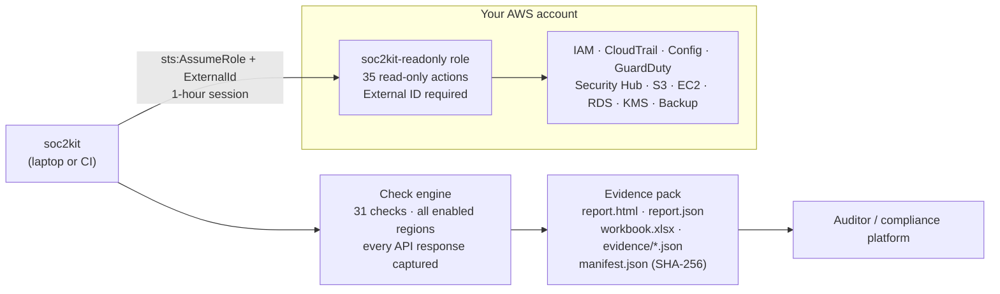

# SOC 2 Evidence Kit for AWS

[](https://github.com/Judewakim/SOC2-Compliance-Workbook/actions/workflows/ci.yml)

`soc2kit` scans an AWS account with a read-only role and produces an **auditor-ready evidence pack** for SOC 2:
pass/fail results mapped to the AICPA Trust Services Criteria, the raw API responses behind every result,
a SOC 2 workbook that also tracks the procedural controls automation cannot see, and a SHA-256 manifest so
the evidence can be shown to be unaltered.

It is built for startups and small teams preparing for a first SOC 2 Type I / Type II who need to know where
their AWS environment stands and to hand an auditor something better than screenshots.

**[Try the demo →](https://wakimworks.com/judewakim/soc2-evidence-kit/)** View a sample report for a fictional
company, or run the scanner in AWS CloudShell and open your own report. The page has no backend; your report
never leaves your browser.

```
soc2-evidence/
├── report.html          # Human-readable report: score, failures, fixes, criteria coverage
├── report.json          # Machine-readable results
├── workbook.xlsx        # SOC 2 workbook: automated results + manual controls with owners/status
├── evidence/            # Raw API responses per check, timestamped (e.g. LOG-01.json)
├── manifest.json        # SHA-256 of every file above
└── soc2-evidence-<account>-<date>.zip
```

## What it checks

31 checks across IAM, logging and detection, data protection, network boundaries and availability.
Run `soc2kit list-checks` for the full list.

| Area | Examples | Criteria |
|---|---|---|
| Identity & access | Root MFA, no root keys, console MFA, 90-day key rotation, stale credentials, `*:*` policies, Access Analyzer | CC6.1-CC6.3 |
| Logging & detection | Multi-region CloudTrail logging, log validation, AWS Config, GuardDuty, Security Hub, VPC flow logs, log retention | CC7.1-CC7.3, CC8.1 |
| Data protection | S3 Block Public Access, TLS-only buckets, versioning, EBS default encryption, RDS encryption, KMS rotation, secret rotation | CC6.1, CC6.7, C1.1 |
| Network | SSH/RDP open to the internet, default security groups | CC6.6 |
| Availability | RDS backups and Multi-AZ, AWS Backup plans | A1.2 |

Every result is one of four states. **A check is never marked as passing unless the evidence shows it passes.**

| Status | Meaning |
|---|---|
| `PASS` | Evaluated, and every resource in scope meets the rule |
| `FAIL` | At least one resource does not meet the rule (each one is listed with a fix) |
| `ERROR` | Could not be evaluated, usually a missing permission. Never counted as a pass |
| `N/A` | No resources in scope (e.g. no RDS databases). Not counted either way |

The workbook also includes 22 **manual controls** (access reviews, background checks, incident response
testing, vendor management, and so on), because most of a SOC 2 audit is process, not configuration.

## Architecture



## Quick start

Fastest path: open [AWS CloudShell](https://console.aws.amazon.com/cloudshell/home) in the account and run

```bash
python3 -m venv ~/soc2kit && ~/soc2kit/bin/pip install -q git+https://github.com/Judewakim/SOC2-Compliance-Workbook.git
~/soc2kit/bin/soc2kit scan --out soc2-evidence
```

then download `soc2-evidence/` with **Actions → Download file**. Python 3.9+ is supported, which matches CloudShell.

From a laptop or CI:

```bash
pip install git+https://github.com/Judewakim/SOC2-Compliance-Workbook.git

# Option 1: scan with your current credentials (must include the permissions in iam/soc2kit-readonly-policy.json)
soc2kit scan --out soc2-evidence

# Option 2 (recommended): deploy the read-only role, then scan through it
soc2kit scan --role-arn arn:aws:iam::111122223333:role/soc2kit-readonly \
             --external-id "$SOC2KIT_EXTERNAL_ID" \
             --out soc2-evidence

open soc2-evidence/report.html
```

Useful flags: `--regions us-east-1,us-west-2`, `--checks IAM-01,LOG-01`, `--fail-on-findings` (exit code 2
on any failure, for CI gates), `--profile <name>`.

## Deploying the read-only role

The role has **no long-lived access keys**. The scanner assumes it with STS and must present an External ID,
which protects against the [confused deputy problem](https://docs.aws.amazon.com/IAM/latest/UserGuide/confused-deputy.html).
Delete the stack to revoke access.

**CloudFormation**

```bash
aws cloudformation deploy \
  --template-file iam/cloudformation/soc2kit-readonly-role.yaml \
  --stack-name soc2kit-readonly \
  --capabilities CAPABILITY_NAMED_IAM \
  --parameter-overrides TrustedPrincipalArn=arn:aws:iam::111122223333:root ExternalId="$SOC2KIT_EXTERNAL_ID"
```

**Terraform**

```bash
cd iam/terraform
terraform init
terraform apply -var trusted_principal_arn=arn:aws:iam::111122223333:root -var external_id="$SOC2KIT_EXTERNAL_ID"
```

## Security design

- **Least privilege, generated from the code.** Each check declares the IAM actions it uses; `soc2kit policy`
  prints the exact policy, and tests fail if the CloudFormation or Terraform policy drifts from it.
- **Read-only, metadata only.** No write actions and no data-plane reads: it never reads S3 objects, secret
  values or log contents. A test enforces this.
- **No shell execution.** Every call goes through boto3. A test fails if `subprocess` or `shell=True` appears.
- **Untrusted strings are neutralised.** Resource names (bucket names, log groups) are HTML-escaped in the
  report and protected against spreadsheet formula injection in the workbook.
- **Output contains account data.** Treat the evidence pack as confidential; `soc2-evidence/` is git-ignored.

## Development

```bash
pip install -e ".[dev]"
pytest -q          # 27 tests against mocked AWS (moto), no account needed
ruff check soc2kit tests
```

Adding a check is one decorated function in `soc2kit/checks/`. Declare its criteria, severity, scope and
permissions, return a list of per-resource findings, then regenerate the policy with
`soc2kit policy > iam/soc2kit-readonly-policy.json` and add the actions to the CloudFormation template.

## Limitations

- Criteria mappings are guidance. Your auditor decides whether a control is sufficient.
- Single account per run. AWS Organizations support (scanning every member account) is on the roadmap.
- Automated checks cover the technical slice of SOC 2. The manual controls in the workbook still need evidence.

## Related projects

- [S3 Sentry](https://github.com/Judewakim/s3-misconfig): finds S3 misconfigurations
- securitystack: deploys an AWS security baseline in one step
- Demo page source: [`web/`](web/)
- Portfolio: [wakimworks.com/judewakim](https://wakimworks.com/judewakim)

## License

MIT. Built by [Jude Wakim](https://github.com/Judewakim).
